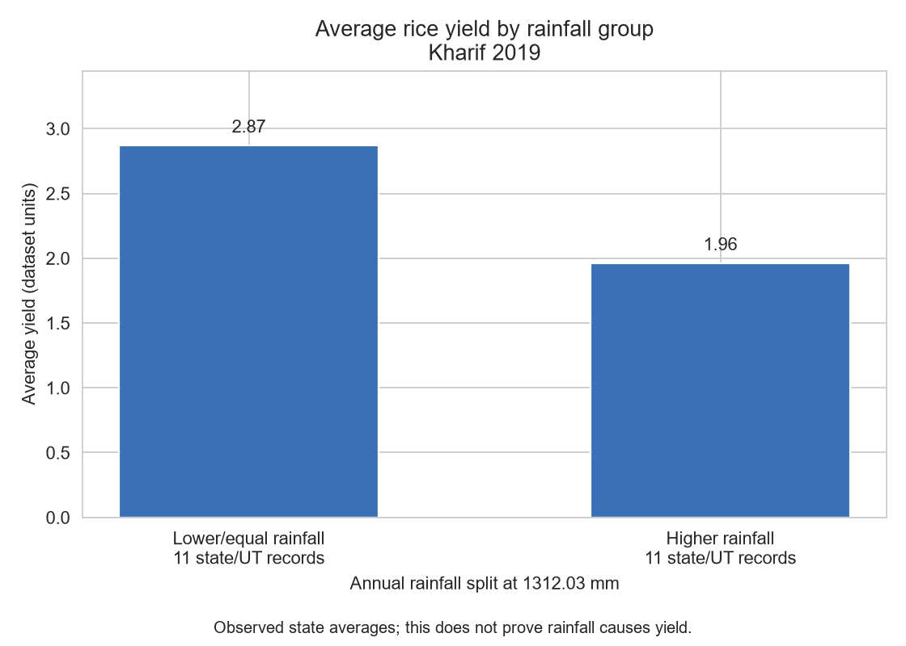

# Analysis of Agricultural Yield Using Soil and Weather Parameters

**Course:** Python Programming Laboratory  
**Institution:** K. J. Somaiya School of Engineering, Somaiya Vidyavihar University, Mumbai  
**Academic Year:** 2026–27  
**Group:** Group 5  
**GitHub Repository:** [https://github.com/shatakshisankhe16112007/python_capstone](https://github.com/shatakshisankhe16112007/python_capstone)

---

## 1. Project Introduction

Agriculture is the primary livelihood source for a majority of India's population. Crop yield productivity is governed by complex agronomic interactions among crop genetic varieties, cultivation area, chemical inputs (fertilizers and pesticides), baseline soil chemistry (Nitrogen, Phosphorus, Potassium, and pH), and annual weather patterns (temperature, precipitation, and relative humidity).

This Capstone Project develops an end-to-end, reproducible computational pipeline in Python that ingests, cleans, explores, visualizes, statistically analyzes, models, and forecasts agricultural crop yields across 30 Indian states and Union Territories over a 24-year historical span (1997–2020). The implementation strictly applies the foundational concepts, procedures, and libraries taught across all 12 laboratory practicals of our Python Programming Laboratory syllabus.

---

## 2. Team Members & Contributions

| Student Name | Module / Role | Primary Responsibilities | Practical Alignment |
|---|---|---|---|
| **Shatakshi Sankhe** | `data_cleaning.py`<br>`visualization.py` | Dataset loading, structural exploration, regional mapping, 3 comprehensive four-panel dashboards, and 17 individual regional factor charts. | Exp 8 (Pandas), Exp 9 (Matplotlib), Exp 10 (Seaborn) |
| **Hitans Sangrajka** | `statistical_analysis.py` | Descriptive statistics across all sources, Rice-Kharif 2019 sample selection, Pearson & Spearman correlations, Welch's independent $t$-test, and rainfall-group comparison bar chart. | Exp 5 (Statistics), Exp 8 (Pandas), Exp 11 (SciPy stats) |
| **Prathamesh Samel** | `common_utils.py`<br>`regression.py`<br>`forecasting.py`<br>`main.py` | Shared utilities, Multiple Linear Regression via SciPy Normal Equations (`scipy.linalg.solve`), time-series stationarity (ADF), differencing, SMA/EWMA, Statsmodels ARIMA, 5-year forecasts, and master pipeline coordination. | Exp 6 (Modules), Exp 7 (NumPy), Exp 11 (SciPy linalg), Exp 12 (Statsmodels Time Series) |

---

## 3. Project Directory Structure

```text
python_capstone/
├── dataset/
│   ├── crop_yield.csv                      # Main agricultural dataset (19,689 rows, 9 cols)
│   ├── state_soil_data.csv                 # State soil chemistry dataset (30 rows, 5 cols)
│   └── state_weather_data_1997_2020.csv    # Annual state weather dataset (720 rows, 5 cols)
├── output_graphs/
│   ├── figure1_regional_production.png      # Dashboard 1: Regional crop production
│   ├── figure2_agricultural_relationships.png # Dashboard 2: Agricultural factor relationships
│   ├── figure3_yield_seasonal_analysis.png  # Dashboard 3: Yield and seasonal analysis
│   ├── visualization/                      # Full suite of 20 dashboards & individual factor graphs
│   ├── statistical_analysis/               # Rainfall-group yield comparison bar chart & correlation analysis
│   ├── regression/                         # 3 regression scatter, correlation & residual plots
│   └── forecasting/                        # 4 time series stationarity, smoothing & ARIMA forecast plots
├── results/
│   ├── statistical_analysis/               # 11 CSV summaries, 2 findings reports & validation doc
│   ├── regression/                         # Model evaluation table & findings summary
│   └── forecasting/                        # ADF tests, smoothing, holdout & future forecast CSVs
├── common_utils.py                         # Reusable loaders, plot helpers & Normal Equations solver
├── data_cleaning.py                        # Dataset loading and structural exploration
├── visualization.py                        # Regional dashboards and agricultural factor plots
├── statistical_analysis.py                 # Descriptive statistics & Welch's independent t-test
├── regression.py                           # First-principles Normal Equations regression & diagnostics
├── forecasting.py                          # Statsmodels ARIMA time series forecasting & smoothing
├── main.py                                 # Master pipeline execution entry point
├── requirements.txt                        # Standardized dependencies (NumPy, Pandas, etc.)
└── README.md                               # Comprehensive project documentation and user guide
```

---

## 4. Dataset Descriptions

The project utilizes three datasets located in the `dataset/` directory:

1. **`crop_yield.csv` (19,689 records × 9 columns)**
   - *Columns:* `crop`, `year`, `season`, `state`, `area`, `production`, `fertilizer`, `pesticide`, `yield`.
   - *Coverage:* Spans 1997 to 2020 across 30 Indian states and union territories for 55 distinct crop types.
   - *Source:* [Kaggle: Crop Yield Data with Soil and Weather Dataset](https://www.kaggle.com/datasets/anshumish/crop-yield-data-with-soil-and-weather-dataset).
2. **`state_soil_data.csv` (30 records × 5 columns)**
   - *Columns:* `state`, `N` (Nitrogen), `P` (Phosphorus), `K` (Potassium), `pH`.
   - *Coverage:* Baseline macronutrient and soil pH values for each of the 30 Indian states.
3. **`state_weather_data_1997_2020.csv` (720 records × 5 columns)**
   - *Columns:* `state`, `year`, `avg_temp_c`, `total_rainfall_mm`, `avg_humidity_percent`.
   - *Coverage:* Exactly 30 states × 24 years (1997–2020) = 720 rows.

---

## 5. Technology Stack & Installation

The project strictly utilizes the 6 permitted standard analytical libraries without external machine learning frameworks:
- `numpy >= 1.24.0` (Array operations and matrix algebra)
- `pandas >= 2.0.0` (DataFrame manipulation, indexing, and joins)
- `matplotlib >= 3.7.0` (2D plotting, subplots, and layouts)
- `seaborn >= 0.12.0` (Statistical distributions and regression plots)
- `scipy >= 1.11.0` (`scipy.linalg.solve` Normal Equations and statistical tests)
- `statsmodels >= 0.14.0` (ADF test and ARIMA time series modeling)

Install all dependencies using:
```bash
python -m pip install -r requirements.txt
```

---

## 6. How to Run the Project

### Running the Complete Pipeline
To execute all five stages sequentially:
```bash
python main.py
```

### Running Modules Independently
Each module can also be run independently from the repository root:
```bash
python data_cleaning.py
python visualization.py
python statistical_analysis.py
python regression.py
python forecasting.py
```

---

## 7. Analytical Modules & Detailed Methodology

### Module 1: `data_cleaning.py` (Shatakshi Sankhe)
- Loads the primary crop dataset and performs programmatic exploration: `.head()`, `.shape`, `.columns`, `.dtypes`, `.isnull().sum()`, `.duplicated().sum()`, and `.describe()`.
- Verifies structural integrity across all records.

---

### Module 2: `visualization.py` (Shatakshi Sankhe)
- **3 Primary Four-Panel Dashboards (12 Subplots):**
  1. `figure1_regional_production.png`: Regional Crop Production Analysis (Total production by region, Top 6 crops across regions, Average crop production heatmap, and Seasonal production by region).
  2. `figure2_agricultural_relationships.png`: Agricultural Factor Relationships using 300 random sample observations (Fertilizer vs. yield with regression line, Pesticide vs. yield with regression line, Cultivated area vs. production bubble chart, and Correlation heatmap).
  3. `figure3_yield_seasonal_analysis.png`: Crop Yield and Seasonal Analysis (Yield distribution across regions, Yield across seasons violin plot, Yearly yield trends across regions, and Regional yield by season boxplots).
- **Full Suite of 20 Visualizations Preserved in `output_graphs/visualization/`:**
  - Standardized dashboards: `figure1_regional_production.png`, `figure2_agricultural_relationships.png`, `figure3_yield_seasonal_analysis.png`.
  - Additional dashboards: `figure2_agricultural_factors.png`, `figure3_yield_distribution.png`, `figure4_correlation_dashboard.png`.
  - Individual regional and factor charts: `graph1_yield_region.png`, `graph2_production_region.png`, `graph3_area_region.png`, `graph4_fertilizer_region.png`, `graph5_pesticide_region.png`, `graph6_yield_boxplot_region.png`, `graph7_yearly_yield.png`, `graph9_correlation_heatmap.png`, `graph10_fertilizer_yield_region.png`, `graph11_yield_region_season.png`, `graph12_area_production_yield.png`.
  - Aggregate crop summaries: `average_yield_by_crop.png`, `crop_yield_by_season.png`, `crop_yield_distribution.png`.

---

### Module 3: `statistical_analysis.py` (Hitans Sangrajka)

*This module provides statistical summarisation, correlation analysis, and two-sample hypothesis testing comparing rainfall regimes.*

#### Simple Code Flow
1. `read_data()`: Opens each CSV, trims spaces, and checks for missing or repeated records.
2. `get_stats()`: Calculates mean, median, mode (preserving ties), sample variance, standard deviation, counts, and ranges.
3. `run_analysis()`: Saves separate descriptive summaries for crop, soil, and weather data.
4. `rice`: Isolates the controlled cross-sectional cohort — **Rice, Kharif, 2019 ($N=22$ states/UTs)** — and merges matching soil and weather records.
5. `pearson` and `spearman`: Measures linear and monotonic relationships between all agricultural/environmental factors and yield.
6. `low` and `high`: Splits records at the median annual rainfall ($1,312.03$ mm) into two groups ($n=11$ each) and executes a two-sided Welch's independent $t$-test.

#### Results and Statistical Findings
- **Sample Cohort:** Rice Kharif 2019 contains 22 state/UT records with an average yield of **2.417356** (dataset units).
- **Correlations with Crop Yield:**
  - Total Annual Rainfall: Pearson $r = -0.570973$, Spearman $\rho = -0.654617$ (moderate negative relationship).
  - Soil Nitrogen (N): Pearson $r = 0.620151$, Spearman $\rho = 0.636698$ (moderate positive relationship).
  - Soil Phosphorus (P): Pearson $r = 0.624994$, Spearman $\rho = 0.677047$ (moderate positive relationship).
  - Soil pH: Pearson $r = 0.494064$, Spearman $\rho = 0.517514$.
  - Soil Potassium (K): Near zero ($r = 0.006408$, $\rho = 0.013057$).
- **Welch's Independent Two-Sample $t$-Test:**
  - **Null Hypothesis ($H_0$):** Mean rice yield is equal between lower/equal and higher rainfall states.
  - **Alternative Hypothesis ($H_1$):** Mean rice yield differs between the two rainfall groups.
  - **Rainfall Cutoff (Median Split):** $1,312.03$ mm.
  - **Lower/Equal Rainfall Group ($n=11$):** Mean yield = **2.871385**.
  - **Higher Rainfall Group ($n=11$):** Mean yield = **1.963327**.
  - **Welch's Test Statistic:** $t = 3.398987$, $\text{df} = 17.474$, $p = 0.00330847$.
  - **Decision:** Since $p < 0.05$, **Reject $H_0$**.
  - **95% Confidence Interval for Mean Difference:** $[0.345573, 1.470543]$.

#### Member 2's Graph



- Saved to `output_graphs/statistical_analysis/rainfall_group_yield.png`.
- The two bars display the average yields of the two rainfall groups compared in the $t$-test: **2.87** for lower/equal rainfall and **1.96** for higher rainfall ($11$ records per group).
- **Viva Note:** *"I split the selected rice records into two rainfall groups, calculated their average yields, and plotted those averages as two bars. I used Welch's t-test to test the difference between the group means."*

#### Assumptions, Controls & Limitations
- The higher observed yield in lower-rainfall states does **not** prove that reducing rainfall improves yield. Lower-rainfall northern states (such as Punjab and Haryana) possess extensive canal and tube-well irrigation infrastructure.
- Weather data is annual; soil data is cross-sectional (no year index); states are not a random sample.
- Yield values are analyzed as supplied in the source Kaggle dataset.

#### Team Integration & Saved Results
- Keeps `run_analysis()`, its 3 return values (`rice`, `test`, `correlations`), all 11 summary CSV files, 2 text findings reports (`hitans_findings.txt`, `member2_findings.txt`), and [`results/statistical_analysis/VALIDATION_MEMBER2.md`](results/statistical_analysis/VALIDATION_MEMBER2.md).

---

### Module 4: `regression.py` (Prathamesh Samel)
- Implements Multiple Linear Regression from first principles using the **Normal Equations**:
  $$(X^T X + \lambda I)\beta = X^T y \implies \beta = \text{scipy.linalg.solve}(X^T X + \lambda I, X^T y)$$
- Excludes `production` to eliminate direct target data leakage; models $\log(\text{yield})$ to normalize variance.
- Uses a time-based train/test split: **Train (1997–2015, $N=15,268$)** and **Test (2016–2019, $N=4,213$)**.
- Evaluates four models on unseen holdout test years:
  - **Baseline Benchmark (Crop Mean):** Test $R^2 = 0.7756$, $\text{RMSE} = 0.6881$.
  - **Model 1 (Factors Only):** Test $R^2 = 0.0018$, $\text{RMSE} = 1.4515$ (raw input factors alone explain $<1\%$ of variance).
  - **Model 2 (Factors + Crop Fixed Effects):** Test $R^2 = 0.7779$, $\text{RMSE} = 0.6847$ (controlling for crop variety substantially improves fit).
  - **Model 3 (Expanded Soil & Weather):** Test $R^2 = 0.7887$, $\text{RMSE} = 0.6678$.
- Confirms significant error reduction over Baseline via paired $t$-test ($p < 0.001$).
- Saves 3 focused figures in `output_graphs/regression/`:
  - `reg_1_correlation_matrix.png`
  - `reg_2_actual_vs_predicted.png`
  - `reg_3_residual_distribution.png`

---

### Module 5: `forecasting.py` (Prathamesh Samel)
- Implements time series analysis aligned with Experiment 12:
  - Formulates yearly median yield series for four staple crops (Rice, Wheat, Maize, Sugarcane) with Pandas `DatetimeIndex`.
  - Conducts Augmented Dickey-Fuller (ADF) testing; applies first-order differencing ($d=1$) to stabilize the mean.
  - Compares 3-year Simple Moving Average (SMA) and EWMA (span=3); demonstrates that EWMA tracks recent shocks with lower Mean Absolute Deviation.
  - Benchmarks candidate Statsmodels $\text{ARIMA}(p, d, q)$ specifications against a Last Value baseline across a 4-year holdout (2016–2019).
  - Refits optimal models on all data through 2019 and generates 5-year future yield projections (2020–2024) with 95% confidence intervals.
- Saves 4 focused figures in `output_graphs/forecasting/`:
  - `fc_1_stationarity_and_differencing.png`
  - `fc_2_smoothing_sma_ewma.png`
  - `fc_3_holdout_evaluation.png`
  - `fc_4_future_forecasts.png`

---

## 8. Verification & Pipeline Execution Summary

Running `python main.py` executes all five stages sequentially in ~18 seconds with zero errors:

```text
============================================================================
 CAPSTONE PROJECT EXECUTION SUMMARY
============================================================================
Step   Analytical Stage                       Author               Status     Runtime
----------------------------------------------------------------------------
Step 1  Data Cleaning & Exploration            Shatakshi Sankhe     SUCCESS    0.09s
Step 2  Data Visualizations (3 Dashboards)     Shatakshi Sankhe     SUCCESS    8.86s
Step 3  Statistical Analysis & Hypothesis Testing Hitans Sangrajka     SUCCESS    0.52s
Step 4  Multiple Linear Regression & Diagnostics Prathamesh Samel     SUCCESS    2.45s
Step 5  Time Series & ARIMA Forecasting        Prathamesh Samel     SUCCESS    6.22s
----------------------------------------------------------------------------
Total Pipeline Runtime: 18.13 seconds.
All output graphs saved to: output_graphs/
All numerical summaries saved to: results/
============================================================================
```
